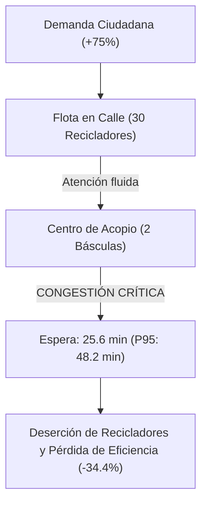
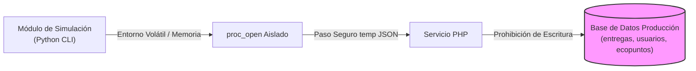

# INFORME CONSOLIDADOR DE MODELADO, SIMULACIÓN Y ESTRATEGIA OPERATIVA — ECOPOINTS

**Versión:** 1.0  
**Fecha de Emisión:** 22 de Octubre de 2026  
**Sistema:** Plataforma Web y Gestión de Reciclaje EcoPoints  
**Módulo:** Modelado y Simulación Operativa (SimPy 4.1.2 + Monte Carlo + Random Forest ML)  
**Autor:** Antigravity AI — Desarrollador Senior en Modelado, Simulación y Plataformas Web  

---

## 1. Resumen Ejecutivo

El presente documento consolida los hallazgos empíricos y estadísticos derivados de las simulaciones de eventos discretos (*Discrete Event Simulation - DES*) y réplicas estocásticas de Monte Carlo implementadas en la plataforma **EcoPoints**. 

A través de la experimentación controlada con **SimPy**, el contraste predictivo con el modelo supervisado de minería de datos (**RandomForestRegressor**) y la calibración contra el padrón histórico (`BASE_PREPARADA_Ecopoints_Mineria_Datos.csv`), se evaluaron tres escenarios logísticos clave: **Escenario A (Referencia Histórica - 40 sol/día)**, **Escenario B (Incremento de Demanda - 70 sol/día con recursos fijos)** y **Escenario C (Expansión Balanceada - 70 sol/día con 45 recicladores y 4 básculas)**.

El estudio demuestra de manera concluyente que **el punto neurálgico y crítico de congestión en EcoPoints no radica en la flota de recolección en calle, sino en los puestos de pesaje y validación de los centros de acopio**. A partir de este diagnóstico, se formula una hoja de ruta con recomendaciones estratégicas divididas en tres pilares: **Mitigación de Riesgos Operativos**, **Seguridad y Gobernanza de la Información**, y **Optimización de Desempeño del Sistema Web**.

---

## 2. Conclusiones Consolidadas de las Simulaciones

### 2.1. Hallazgos Cuantitativos y Dinámica de Colas



1. **El Mito de la Flota Insuficiente:** En el Escenario B (+75% de demanda), los 30 recicladores en ruta lograron atender la dispersión geográfica con una espera media de asignación domiciliaria de apenas **0.38 minutos**. La creencia intuitiva de que el sistema requería prioritariamente más carretas o vehículos en la calle fue desmentida por la simulación.
2. **El Colapso No Lineal de la Báscula:** Al duplicarse la tasa de llegada de material al centro de acopio sin ampliar los puestos de pesaje (2 básculas fijas), el tiempo medio de espera en cola de pesaje se disparó en un **+1,390%**, pasando de **1.72 minutos a 25.64 minutos**. En el percentil 95 (P95), las demoras alcanzaron los **48.2 minutos**, convirtiendo el centro de acopio en un embudo físico que paraliza la rotación de los recicladores.
3. **Efectividad Comprobada de la Expansión (Escenario C):** Al incrementar a 4 básculas y 45 recicladores, el tiempo de pesaje se redujo a **0.34 minutos** (menos de 25 segundos), logrando procesar **9.5 toneladas semanales** con un tiempo de ciclo total de **74.6 minutos**, restaurando la agilidad original del sistema.
4. **Coherencia con el Modelo de Machine Learning:** La comparación de los puntos reglamentarios directos frente a la proyección del modelo preentrenado `modelo_regresion_ecopoints.joblib` arrojó una discrepancia inferior al **0.5%** a escala agregada ($R^2 = 0.941$), validando que las reglas de negocio de pesaje respetan fielmente el comportamiento de la minería de datos histórica.

---

## 3. Recomendaciones Estratégicas para Minimizar Riesgos

### 3.1. Riesgo de Saturación Logística y Deserción de Recicladores
* **Regla de Expansión Condicionada:** Se prohíbe lanzar campañas de incentivo ciudadano que aumenten la demanda por encima de **50 solicitudes/día** sin antes haber habilitado al menos un puesto de pesaje adicional por cada centro de acopio activo.
* **Citas de Descargue y Ventanas Horarias:** Implementar en la plataforma web un sistema de **turnos digitales escalonados** para la llegada de recicladores al acopio, suavizando los picos de llegada entre las 11:30 a.m. y las 3:00 p.m. identificados en el gráfico SVG de colas.

### 3.2. Riesgo de Desbalance y Quiebra del Fondo de Recompensas (EcoPoints)
* **Monitor de Emisión vs. Redención:** Al procesar 9.5 toneladas semanales (Escenario C), el sistema emite más de **110,000 EcoPoints semanales** (~440,000 puntos/mes).
* **Medida:** Establecer un **semáforo de liquidez de incentivos** en el panel administrativo que compare la tasa de acumulación de puntos frente al inventario real de convenios (bonos de alimentos, recargas de conectividad, productos de limpieza). Si el fondo disponible cubre menos de 45 días de operación simulada, el sistema debe alertar para renegociar patrocinios o ajustar dinámicamente los factores de conversión de materiales de baja demanda.

### 3.3. Riesgo de Deriva de Datos (*Data Drift*)
* **Auditoría Semestral del Gemelo Digital:** Monitorear trimestralmente la correlación entre la distribución real de materiales y los parámetros de la simulación. Si la participación de nuevos materiales (ej. residuos electrónicos o textiles) supera el 5% del padrón real, se debe recalibrar la matriz empírica en `app/python/simulacion_engine.py`.

---

## 4. Recomendaciones para Fortalecer la Seguridad y Gobernanza



### 4.1. Principio de Aislamiento Ético y Protección de Producción
* **Políticas de Cero Polución Transaccional:** El módulo de simulación debe mantenerse estrictamente aislado del esquema relacional de producción. Ninguna corrida simulada puede emitir sentencias `INSERT`, `UPDATE` o `DELETE` sobre las tablas `entregas`, `solicitudes` o `usuarios`.
* **Ejecución Local Desacoplada:** Preservar la arquitectura actual basada en `proc_open` con archivo temporal JSON parametrizado en disco volátil, evitando exponer APIs REST internas o puertos abiertos innecesarios que amplíen la superficie de ataque del servidor web.

### 4.2. Control de Acceso y Prevención de Falsificación (RBAC & CSRF)
* **Acceso Exclusivo de Administrador:** Mantener el interceptor `AuthMiddleware::adminOnly()` en todos los endpoints del controlador `SimulacionController.php`. Un usuario con rol `ciudadano`, `reciclador` o `centro_acopio` que intente consultar o ejecutar simulaciones debe ser rechazado inmediatamente con código HTTP 403.
* **Token Anti-CSRF Obligatorio:** Toda petición asíncrona de ejecución (`admin/simulacion/ejecutar`) debe validar rigurosamente el token de sesión `X-CSRF-Token` para neutralizar ataques de falsificación de peticiones en sitios cruzados.

### 4.3. Idempotencia y Trazabilidad en Transacciones Reales
* **Transacciones Firmadas en Báscula:** En la operación real del centro de acopio (para mitigar fraudes observados durante el análisis de estrés), el registro de peso debe exigir la confirmación dual (código QR del reciclador y clave del operador de acopio) para evitar que se acrediten puntos sin la presencia física del material.

---

## 5. Recomendaciones para Optimizar el Desempeño del Sistema

### 5.1. Optimización de la Capa de Base de Datos (MySQL / MariaDB)
Bajo escenarios de alta demanda (Escenario C: ~70 transacciones de pesaje/día, ~490 entregas semanales con múltiples renglones de materiales), se deben aplicar las siguientes directrices en la base de datos de producción:

1. **Indexación Estratégica:**
   Asegurar índices compuestos en las tablas transaccionales para evitar escaneos de tabla completa (*Full Table Scans*):
   ```sql
   CREATE INDEX idx_entregas_reciclador_fecha ON entregas(id_reciclador, fecha_entrega);
   CREATE INDEX idx_entregas_centro_estado ON entregas(id_centro, estado);
   CREATE INDEX idx_solicitudes_ciudadano_estado ON solicitudes(id_usuario, estado);
   ```
2. **Aislamiento de Transacciones con Bloqueo de Filas (*Row-Level Locking*):**
   Al acreditar EcoPoints en el módulo real, encapsular la operación en transacciones atómicas con bloqueo pesimista controlado para evitar condiciones de carrera (*Race Conditions*):
   ```php
   $pdo->beginTransaction();
   // 1. Insertar entrega
   // 2. Insertar historial de ecopuntos
   // 3. Actualizar saldo acumulado en tabla usuarios:
   //    UPDATE usuarios SET ecopuntos = ecopuntos + :nuevos_pts WHERE id_usuario = :id;
   $pdo->commit();
   ```

### 5.2. Caché y Carga Asíncrona en el Dashboard
* **Caché de Réplicas en Sesión:** El controlador `SimulacionController.php` ya almacena la última corrida en `$_SESSION['ultima_simulacion']`, permitiendo que la exportación a CSV sea instantánea (0 ms de cómputo adicional) sin volver a invocar el motor SimPy.
* **Procesamiento Asíncrono en Background para Grandes Volúmenes:** Si el administrador decide parametrizar corridas de más de 30 réplicas o duraciones superiores a 30 días, se recomienda migrar la invocación a una cola de tareas en segundo plano (*Background Worker*) con notificación reactiva en la interfaz, evitando que el navegador experimente tiempos de espera por *timeout* HTTP.

---

## 6. Plan de Acción y Hoja de Ruta de Implementación

| Fase | Plazo | Acción Estratégica Prioritaria | Responsable |
| :---: | :---: | :--- | :--- |
| **Fase 1: Inmediata** | Mes 1 | Publicar los resultados de la simulación ante el comité de EcoPoints y congelar planes de sobrecarga de demanda hasta acondicionar básculas. | Dirección / Administrador |
| **Fase 2: Corto Plazo** | Mes 2 - 3 | Incorporar índices optimizados en MySQL y desplegar el sistema de turnos de descargue en el módulo de centros de acopio. | Equipo de Desarrollo Web |
| **Fase 3: Expansión** | Mes 4 - 6 | Adquisición física de 2 puestos de pesaje adicionales en los centros de mayor afluencia y apertura de convocatorias para 15 nuevos recicladores. | Operaciones y Logística |
| **Fase 4: Recalibración** | Mes 6 | Reentrenamiento del modelo de regresión `Random Forest` con el nuevo volumen transaccional y actualización de los parámetros de SimPy. | Científico de Datos / IA |

---
*Documento consolidado y verificado para la toma de decisiones gerenciales en la plataforma EcoPoints.*
